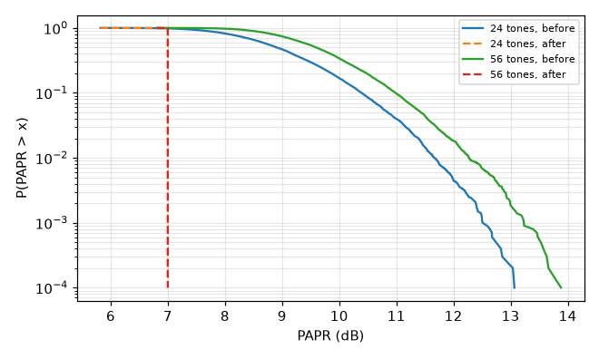

# Stage 1 simulation report

Generated by `python -m cairn_sim.report` from `sim/results/`. Audio SNR is defined in `sim/README.md`.

## Rung thresholds (1% block error)

AWGN sweep not yet run.

## Clip level against rung threshold (AWGN, 24 tones)

Clip sweep not yet run.

## PAPR before and after clip-and-filter (SPEC 7.1)

| Width | Before: median / 99.9% / max (dB) | After: median / max (dB) |
| --- | --- | --- |
| 24 | 8.9 / 12.5 / 13.1 | 7.0 / 7.00 |
| 56 | 9.6 / 13.2 / 13.9 | 7.0 / 7.00 |

10,000 random 16-QAM symbols per width.

### In-band distortion left by clipping

| Clip level (dB above RMS) | Signal-to-distortion (dB), 24 tones |
| --- | --- |
| 6 | 17.8 |
| 7 | 21.7 |
| 8 | 25.9 |
| 9 | 31.0 |
| 10 | 36.7 |

## Time budget and net throughput (SPEC 7.4, Appendix A.2)

Frames of 2 s at MCS 0–1 and 4 s otherwise, TXDelay 150 ms, peer ACK cycle 0.51 s. The cycle uses the frame's actual length (Appendix A assumes a full frame).

| MCS | Blocks 24 / 56 | Symbols per block 24 / 56 | Cycle (s) | Net kbps 24 / 56 | A.2 net kbps |
| --- | --- | --- | --- | --- | --- |
| 0 | 3 / 7 | 46.5 / 19.7 | 2.36 | 1.28 / 3.01 | 1.2 / 2.9 |
| 1 | 4 / 11 | 31.1 / 13.2 | 2.19 | 1.84 / 4.58 | 1.6 / 4.5 |
| 2 | 14 / 33 | 23.3 / 9.8 | 4.46 | 3.17 / 7.48 | 3.2 / 7.5 |
| 3 | 21 / 50 | 15.5 / 6.6 | 4.47 | 4.74 / 11.22 | 4.8 / 11.3 |
| 4 | 28 / 67 | 11.6 / 4.9 | 4.46 | 6.33 / 15.00 | 6.3 / 15.1 |
| 5 | 35 / 83 | 9.3 / 3.9 | 4.47 | 7.90 / 18.68 | 7.9 / 19.0 |
| 6 | 42 / 100 | 7.8 / 3.3 | 4.47 | 9.48 / 22.44 | 9.5 / 22.6 |

SPEC 7.4 worked example (24 tones, MCS 3, 4 s): 21 blocks, cycle 4.465 s, 4.74 kbps net (spec: 21 blocks, 4.46 s, 4.75 kbps).

### Net throughput against TXDelay and frame length (24 tones, MCS 3)

| TXDelay \ frame | 1 s | 2 s | 3 s | 4 s |
| --- | --- | --- | --- | --- |
| 50 ms | 2.90 | 4.13 | 4.62 | 4.85 |
| 150 ms | 2.70 | 3.83 | 4.43 | 4.74 |
| 300 ms | 2.06 | 3.44 | 4.16 | 4.54 |
| 500 ms | 1.35 | 2.98 | 3.84 | 4.29 |
